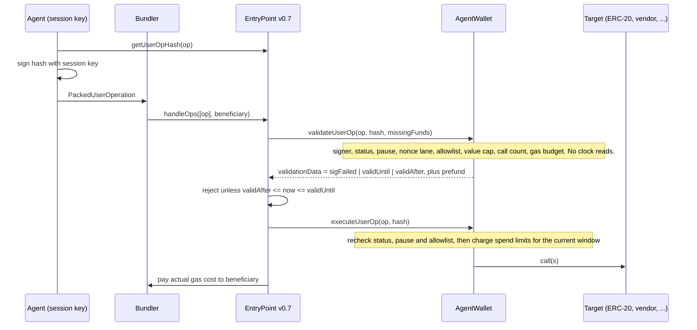

<p align="center">
  
</p>

# agent-wallet

An ERC-4337 smart account for AI agents. The owner hands an agent a session key, and the contract enforces what that key can do: which contracts and functions it can call, how much of each token it can move per day, how much ETH per call, how many calls in total, how much gas it can burn, and for how long. The owner or a guardian can pause every session key with one transaction.

Built with Foundry against the eth-infinitism EntryPoint v0.7.0. Not audited. Don't put real money in it.

## Why I built this

Agents are starting to pay for things and call contracts on their own. The easy way to let one do that is to give it a private key, and that's a bad idea. A prompt injection or a leaked environment variable then costs you everything in the wallet.

What I wanted was a key the agent can hold that is only good for a narrow job. "Pay this vendor up to 100 USDC a day for the next week, and nothing else." If the key leaks, the damage is capped by rules the chain enforces, not by the agent behaving.

ERC-4337 session keys are the obvious tool for this. I wanted to find out how tight those limits can get before the ERC-4337 validation rules get in the way, and the answer turned out to be more interesting than I expected. Some checks can run before the operation is accepted. Others can't, because validation isn't allowed to read the clock, and that split drives most of the design.

## What I looked at

- **SimpleAccount** from eth-infinitism, as the baseline for `validateUserOp`, prefund payment and nonce handling.
- **ERC-7562**, the validation rules bundlers enforce. This decides where each check can live.
- **Modular accounts** under ERC-7579 and ERC-6900, and the session key and permission modules built on them. They make policies pluggable. I went with one contract instead, because I wanted the whole policy readable in a single file and testable end to end.
- **Coinbase Smart Wallet's `replaySafeHash`**, which wraps ERC-1271 hashes in an EIP-712 domain tied to the account. I use the same idea.

## How it works



A session operation has a fixed shape:

```
userOp.callData  = executeUserOp.selector ++ abi.encode(Call[])
userOp.nonce     = uint192(sessionKey) << 64 | sequence
userOp.signature = 0x01 ++ sessionKey (20 bytes) ++ r ++ s ++ v
```

The owner signs `0x00 ++ r ++ s ++ v` and can send any calldata. Both sign the EIP-191 digest of the user op hash.

`executeUserOp` is the v0.7 hook where the EntryPoint passes the entire user operation, signature included, to the account at execution time. Without it the execution phase can't tell which key signed, so it couldn't charge the right spend limit. The signature bytes it reads there are the same calldata that passed validation a moment earlier in the same `handleOps` call, so they are authenticated.

Each session key gets its own EntryPoint nonce lane, keyed by its address. An agent's stuck operation never blocks the owner or another agent, and `getSessionNonce(key)` doubles as a per-session usage counter.

## Policy model

| Rule | Set in `SessionParams` | Enforced | Error |
|---|---|---|---|
| Validity window | `validAfter`, `validUntil` (required) | EntryPoint, from `validationData` | `AA22 expired or not due` |
| Target and selector allowlist | `permissions[]`, `bytes4(0)` means plain ETH transfer | validation and execution | `CallNotAllowed` |
| ETH per call | `maxValuePerCall` | validation and execution | `ValuePerCallExceeded` |
| Total calls | `maxCalls`, each batch entry counts | validation | `SessionCallLimitExceeded` |
| Gas budget | `gasBudget`, in wei of worst-case prefund | validation | `SessionGasBudgetExceeded` |
| Spend per period | `spendLimits[]`, per token plus `address(0)` for ETH | execution | `SpendLimitExceeded` |
| Nonce lane | implicit, key = session address | validation | `InvalidSessionNonceKey` |
| Revocation | `revokeSession(key)`, permanent | validation, as a bad signature, and execution | `AA24`, `SessionNotActive` |
| Pause | `pauseSessions()`, owner or guardian | validation and execution | `SessionsArePaused` |

Some rules are enforced when the owner calls `addSession`, so a bad policy never gets stored:

- A token with a spend limit can only be called through `transfer` and `approve`. Anything else on that token, like `transferFrom`, `increaseAllowance`, `permit` or ERC-677 `transferAndCall`, would move funds without being metered, so it's refused.
- Allowing `transfer` or `approve` on a target requires a spend limit for that target. You can't accidentally grant an unlimited token permission.
- The account itself and the EntryPoint can never be targets. That shuts off calling admin functions through the account and withdrawing its EntryPoint deposit.
- ETH can only be spent if there is a limit for `address(0)`. The defaults are all zero, so an empty policy allows nothing.
- `validUntil` is required and must be in the future. Sessions can't be open-ended.
- A key can be registered once. After revocation it can't come back with stale counters.

`approve` is charged at its full amount, since an approval is permission to spend. `approve(spender, 0)` is free. Spend periods are fixed windows aligned to `block.timestamp / period`, with period 0 meaning one window for the life of the key.

## Where each check runs, and why

ERC-7562 constrains what `validateUserOp` may do if a bundler is going to accept the operation. The rules that mattered here:

1. **No `TIMESTAMP` or `NUMBER` in validation.** The account can't check expiry itself. It returns `validAfter` and `validUntil` packed into `validationData` and the EntryPoint compares them with the block time. The same rule is why spend limits can't be checked in validation, since "100 per day" needs to know what day it is.
2. **Storage access is limited to the account's own storage** for an unstaked account, plus slots in other contracts keyed by the account's address. So the whole policy lives in the account's own storage. Validation can't look at token balances or call other contracts.
3. **`GAS` is only allowed right before a call.** The prefund payment passes an explicit gas value so the compiler doesn't emit a bare `GAS`.
4. **The EntryPoint validates every op in a bundle before executing any of them.** An owner op that pauses sessions or revokes a key can land between a session op's validation and its execution. So execution rechecks status and pause. There's an end-to-end test for exactly this case.

So the account does everything it can in validation, where a failure means the bundler drops the op and nobody pays. What needs the clock happens in execution:

| Check | Validation | Execution | Reason |
|---|---|---|---|
| Signature and signer status | yes | reads signer from validated signature | revoked keys return `SIG_VALIDATION_FAILED` |
| Pause | yes | yes | can flip mid-bundle |
| Revocation | yes | yes | can flip mid-bundle |
| Allowlist, value cap, calldata shape | yes | yes | cheap to repeat, slots are warm |
| Call count, gas budget | yes | no | counted once, when the op is accepted |
| Validity window | returned in `validationData` | no | EntryPoint checks it |
| Spend limits | no | yes | need `block.timestamp` |

The consequence is that an operation that breaks a spend limit gets included, reverts in execution, and still pays for its gas. A leaked key could repeat that to burn the account's ETH, and with a colluding bundler it could set a huge `maxFeePerGas` and burn a lot of it. That's what the gas budget is for. Validation charges each op's worst-case prefund, `(verificationGasLimit + callGasLimit + preVerificationGas) * maxFeePerGas`, against a per-session budget. That's computable from the user op fields alone, with no banned opcodes.

One caveat I want to be upfront about. I wrote the validation path to follow ERC-7562, but I haven't run it through a bundler's tracer. The tests call `handleOps` directly. A real mempool bundler could still reject something I missed.

## Threat model

**Compromised agent key.** This is the main case. The attacker can do what the policy allows until the key expires, runs out of calls, or someone pauses or revokes it. They can move up to the spend limit per window, send ETH only to allowlisted addresses, and burn gas up to the gas budget. They can't call admin functions, sign ERC-1271 messages, touch the EntryPoint deposit, or use the owner signature mode. Fixed windows mean they can spend the limit at the end of one window and again at the start of the next, so plan for 2x the limit over a short span.

**Malicious or compromised target.** If an allowlisted contract is malicious, it gets whatever the session sends it and whatever the account has approved to it. Calls back into the account fail, since `execute`, admin functions and `executeUserOp` reject other callers, and the EntryPoint's `handleOps` is non-reentrant. Allowances outlive a session. If the agent approved a router, revoking the key doesn't revoke the approval, so the owner should reset approvals when shutting a session down.

**Replay.** The user op hash covers the account, the chain id and the EntryPoint, so a signature is valid for one account on one chain. The EntryPoint nonce stops same-account replay, and there are tests for both. ERC-1271 signatures go through `replaySafeHash`, so a signature for one account isn't valid on another account with the same owner.

**Session keys signing permits.** `isValidSignature` only accepts the owner. If session keys could produce ERC-1271 signatures they could sign Permit2 or EIP-2612 permits and move tokens without touching the spend limits.

**Griefing.** A leaked key can make the account pay gas for failing operations, bounded by the gas budget and `maxCalls`. Calls that fail in execution still count against `maxCalls`. That's deliberate, because the alternative lets an attacker loop failing ops for free against the call limit.

**Front-running deployment.** The factory's CREATE2 salt includes the owner and guardian. Someone who sees a funded counterfactual address can't deploy it first with their own owner.

**Out of scope.** A compromised owner key controls everything, which is the point of an owner. There is no recovery, no multisig owner and no timelock. A malicious bundler can censor or delay operations but can't change them.

## Other design choices

- **EntryPoint v0.7.0**, pinned by submodule. It has the `executeUserOp` hook this design depends on, and it's a stable, widely deployed release, at `0x0000000071727De22E5E9d8BAf0edAc6f37da032` on public networks. v0.8 would work too. It adds EIP-7702 support and EIP-712 user op hashes, neither of which I needed.
- **EIP-1167 clones, no upgrades.** An upgradeable account means an upgrade key, and the owner key already has to stay safe. The account also never uses `delegatecall`, so the implementation can't be destroyed or hijacked, and the constructor disables initializers on it.
- **The guardian can only pause.** It has no signature mode in `validateUserOp` and fails the access check on every other function. Only the owner can unpause.
- **Owner rotation** through `transferOwnership`. Existing session keys stay valid across a rotation, and the new owner can't be an address that was ever a session key.
- **Policy checks run even when the session signature is wrong**, so a bundler estimating gas with a dummy signature sees the same code path. Whatever validation wrote is discarded when the EntryPoint rejects the signature.

## Tests

```
forge test                          # local profile, about 5 seconds
FOUNDRY_PROFILE=ci forge test       # what CI runs, about 75 seconds locally
```

150 tests in total:

- **92 unit tests.** 6 for the factory, 41 for owner, guardian and config paths, 29 for the validation phase and 16 for the execution phase, each phase called directly as the EntryPoint. Every policy rule has its own test. That covers expired and not-yet-valid keys, wrong target, wrong selector, spend over limit, period reset at the exact boundary second, value cap, call count, gas budget, revoked keys, pause, a batch with one bad call, `transfer` and `approve` decoding, and owner rotation.
- **28 end-to-end tests** through a real `EntryPoint.handleOps` with signatures from `vm.sign`. Counterfactual deployment through `initCode`, prefund from balance and from deposit, `AA21` on insufficient funds, `AA22` on expiry, `AA24` for a random key, where the account returns `SIG_VALIDATION_FAILED` instead of reverting, `AA25` on replay, policy failures surfacing as `AA23`, over-limit ops reverting in execution while still paying gas, and pause or revoke landing in the same bundle as an already-validated session op.
- **11 fuzz properties** over amounts, timestamps, selectors, targets and gas fields. 256 runs each locally, 10,000 in CI.
- **6 invariants** driven by a handler that randomly adds and revokes sessions, pauses and unpauses, warps time, sweeps funds as the owner, and submits session ops through the EntryPoint. Some of those ops are fine, some break policy, and some come from keys that were never registered. 64 runs at depth 64 locally, 512 runs at depth 128 in CI. The handler keeps its own ledger instead of reading back the contract's counters:
  1. Total spent by any session key of any asset within any window never exceeds that asset's limit.
  2. The contract's stored spend never exceeds the limit either.
  3. A revoked, expired, not-yet-valid or paused key never gets an operation through, and no out-of-policy or unregistered-key operation succeeds.
  4. Tokens only leave the account to allowlisted recipients through sessions, or to the owner's sink.
  5. ETH only goes to allowlisted destinations, the owner's sink, or the bundler as gas, and the total is conserved.
  6. `callsUsed <= maxCalls` and `gasSpent <= gasBudget` for every key, and the owner never changes.

  In one CI-profile run of 65,536 handler calls, 8,203 session ops succeeded, 1,996 were included and reverted in execution, and 22,565 were rejected in validation.
- **13 gas measurements**, written to `snapshots/`.

### Coverage

`forge coverage --report summary --no-match-coverage "(test|script)/"`:

| File | Lines | Statements | Branches | Functions |
|---|---|---|---|---|
| src/AgentWallet.sol | 100% (217/217) | 100% (276/276) | 100% (45/45) | 100% (41/41) |
| src/AgentWalletFactory.sol | 100% (13/13) | 100% (15/15) | 100% (1/1) | 100% (4/4) |

100% coverage means every line ran. It doesn't mean every line is right, which is why the invariants exist.

## Gas

Measured with Foundry v1.4.3 and `vm.startSnapshotGas` around the `handleOps` call, with storage cooled first. These exclude the 21,000 base transaction cost and calldata. Unless noted, the account and session have already done one operation, so the numbers reflect steady state rather than first-write costs.

| Flow | Gas |
|---|---|
| Owner op, ETH transfer | 80,094 |
| Owner op, ERC-20 transfer | 88,868 |
| Session op, ERC-20 transfer | 110,264 |
| Session op, ERC-20 transfer, first window of a new day | 110,161 |
| Session op, ERC-20 transfer, first op for a new session | 225,351 |
| Session op, ETH transfer | 110,057 |
| Session op, batch of three ERC-20 transfers | 133,095 |
| Deploy account via `initCode` plus owner ETH transfer | 273,226 |
| `factory.createAccount` | 127,908 |
| `addSession` with the default test policy: 3 targets, 4 selectors, 2 limits | 224,274 |
| `revokeSession` | 6,905 |
| `pauseSessions` | 14,334 |
| Plain ERC-20 transfer from an EOA, for reference | 10,501 |

A session ERC-20 transfer costs about 21k gas more than the same transfer signed by the owner.

Full transaction receipts from the anvil demo, including base cost and calldata: 228,960 gas for the agent's first payment, 213,020 for a batch of one token transfer and one ETH transfer, and 121,336 for an op that was included and reverted on its spend limit.

## Static analysis

`forge lint` is clean on `src/`. The lints I disagree with for this code are either excluded in `foundry.toml` or disabled inline, each with the reason next to it.

Slither 0.11.6, run with `uvx --from slither-analyzer slither .`, reports 24 results across 11 detectors on `src/`. I went through each one:

| Detector | Where | Disposition |
|---|---|---|
| arbitrary-send-eth, low-level-calls, calls-loop | `_call`, `_payPrefund` | Intended. `_call` is how an account makes calls, and every path into it is owner-only or policy-checked. `_payPrefund` pays `msg.sender`, which `onlyEntryPoint` pins to the EntryPoint. |
| return-bomb | `_payPrefund` | The callee is the EntryPoint, which returns nothing. |
| incorrect-equality, timestamp | spend windows, `addSession` | Window index comparisons are meant to be exact. Validator timestamp drift of a few seconds doesn't matter for daily limits. |
| unused-return | `_recover` | The error is checked. Slither flags the third return value, which is only the malformed `s` or length. |
| missing-zero-check | guardian setters | Zero means no guardian. |
| reentrancy-events | factory `createAccount` | The only external call is to the clone deployed on the previous line. |
| assembly | three small blocks | Revert bubbling and reading a selector and an amount from memory, each commented. |
| naming-convention | `ENTRY_POINT`, `ACCOUNT_IMPLEMENTATION` | Immutables in upper case, on purpose. |

The only code change that came out of this was handling `tryRecover`'s error explicitly.

## Running it

Requires Foundry, and Node 22.18 or later for the demo.

```
git clone --recurse-submodules <repo>
cd agent-wallet
forge build --sizes
forge test
./scripts/demo.sh
```

`scripts/demo.sh` starts a throwaway anvil, deploys an EntryPoint v0.7.0, the factory, a test token and an account, and grants a session key. Then `agent/demo.ts` plays the agent. It builds a `PackedUserOperation`, gets the hash from the EntryPoint, signs it with the session key using viem, and submits it with `handleOps` from a stand-in bundler account. There's no bundler or mempool involved. The script pays a vendor, sends a batch, tries to overspend, tries two calls outside the policy, and tries again after the guardian pauses. It exits non-zero if any step ends differently than expected, and CI runs it.

```
> pay the vendor 25 TUSD
  handleOps gasUsed 228960, op paid 0.00035894207996034 ETH
  op succeeded
  remaining today: 75 TUSD, 0.1 ETH | calls 1/20 | ...
> try to pay 80 TUSD (only 65 left today)
  op included but reverted in execution: SpendLimitExceeded(...)
> try to send TUSD to the agent's own address via transferFrom
  rejected in validation, not submitted: AA23 reverted: CallNotAllowed(..., 0x23b872dd)
> pay the vendor 1 TUSD while paused
  rejected in validation, not submitted: AA23 reverted: SessionsArePaused()
```

## Layout

```
src/
  AgentWallet.sol              the account
  AgentWalletFactory.sol       CREATE2 clone factory
  interfaces/                  IAgentWallet types, events, errors; minimal ERC-4337 v0.7 interfaces
test/
  unit/                        per-phase and admin tests
  e2e/                         through EntryPoint.handleOps
  fuzz/                        property tests
  invariant/                   handler and invariants
  gas/                         gas snapshots
  utils/, mocks/               fixture, EntryPoint artifact import, mock token and target
script/DeployLocal.s.sol       anvil deployment for the demo
agent/demo.ts                  the agent side, using viem
scripts/demo.sh                runs the whole demo
snapshots/                     measured gas
```

## Limitations

- Fixed spend windows allow up to twice the limit across a window boundary. A rolling window would fix that, at the cost of more storage per session.
- Only `transfer` and `approve` are decoded. Swaps and other flows work through the allowlist and approvals, but the limit applies to what the account approves, not to what a router later pulls.
- Fee-on-transfer and rebasing tokens are charged the nominal amount in the calldata.
- The gas budget is charged the worst case, not the actual cost, so it runs out faster than real spend. Ops that use a paymaster aren't charged at all. If the owner has given a token paymaster an allowance, that paymaster can take tokens for session ops outside the spend limits.
- Session policies can't be edited. To change one, revoke the key and issue a new one.
- The owner is a single ECDSA key. There are no passkeys, no multisig, and no recovery.
- No ERC-721 or ERC-1155 receiver hooks, so `safeTransferFrom` of NFTs to the account reverts.
- Validation hasn't been run through a real bundler's ERC-7562 tracer, only through `handleOps` in tests.
- Only EntryPoint v0.7.

## Not audited

I wrote this to learn and to show how the pieces fit together. Nobody has audited it. Don't use it with real funds.

## License

MIT, see [LICENSE](LICENSE). The account doesn't import any GPL code. It talks to the EntryPoint through the MIT interfaces in `src/interfaces`. The one file that imports the EntryPoint source, so the build compiles it for tests and the demo, is `test/utils/EntryPointArtifact.sol`, and it's GPL-3.0 to match eth-infinitism/account-abstraction. OpenZeppelin Contracts is MIT and forge-std is MIT or Apache-2.0.
